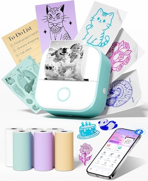

# pocket-printer

[](https://www.npmjs.com/package/pocket-printer)
[](./LICENSE)

Do you have a kids "inkless" thermal printer? Brands like Phomemo, models like M02, T02, etc
This library is for you! 



## Why? 
My kids got these cheap thermal printers that are meant to print from an phone app. The biggest problem is the phone app is malware and sends things location data to a server somewhere! I wanted to print to it from my own custom projects but the devices don't work with standard ESC/POS protocol that a thermal printer should. These cheap devices don't do the necessary things like bundle a font onto their firmware. 
So Claude and I figured out the actual command set to talk to these things and I made my own library to use in my other projects since I was copying around some code chunks to do specific things like print pictures for the kids. 
Hope this is useful if you've been fighting one of these devices like I was. 

**Please submit questions, suggestions, or bugs in issues!**
Did this not work for your printer? Submit an issue with the brand, model, etc.. 

## What
Print text and images to **Phomemo M02** (or similar) family thermal printers over Bluetooth LE, from
**Node**, **Bun** or the **browser**.

Th is a raster-only printer: it has no font ROM and ignores ESC/POS text commands.
This library renders everything (text, rules, images) to a 1-bit bitmap on the host and
sends it with the one command the printer understands. Text uses a bundled copy of
[JetBrains Mono](https://www.jetbrains.com/lp/mono/), so output is identical on every machine.

- **High-level document API**: word-wrapped text, sizes, bold, alignment, line feeds, rules,
  dithered images, all chainable.
- **Two transports**: [`@abandonware/noble`](https://github.com/abandonware/noble) in
  Node/Bun, [Web Bluetooth](https://developer.mozilla.org/docs/Web/API/Web_Bluetooth_API)
  in Chrome/Edge. `connect()` picks the right one.
- **Bring your own connection**: pass a peripheral, device or GATT server you already manage.
- **Status**: battery, firmware, serial, paper, cover and temperature. (if available)
- **Dependency-free core** (`pocket-printer/core`): protocol bytes, bitmap packing and the `Printer`
  class, for custom transports or renderers.
- **CLI**: `pocket-printer text`, `pocket-printer image`, `pocket-printer status`, with a `--preview` mode that needs no printer.

Tested on an M02 (firmware 1.0.1). The M02S and M02 Pro use the same protocol at wider
widths and are supported through the `model` option but have not been verified on hardware.

## Contents

- [Install](#install)
- [Quick start](#quick-start)
- [CLI](#cli)
- [Document API](#document-api)
- [Printer API](#printer-api)
- [Connecting](#connecting)
- [Sizes and units](#sizes-and-units)
- [Browser usage](#browser-usage)
- [Low-level API](#low-level-api)
- [Printer models](#printer-models)
- [Power and charging](#power-and-charging)
- [Troubleshooting](#troubleshooting)
- [Development](#development)

## Install

```sh
npm install pocket-printer      # or: bun add pocket-printer
```

Requirements:

- Node 18+ or Bun. In the browser, Chrome or Edge (Safari and Firefox have no Web Bluetooth).
- Node/Bun transport: `@abandonware/noble` is an optional dependency with a native module. On
  macOS it builds out of the box; on Linux see the
  [noble prerequisites](https://github.com/abandonware/noble#prerequisites). If it fails to
  install you can still use the browser entry and the rendering functions.
- Text rendering uses `@napi-rs/canvas`, image decoding uses `sharp`. Both ship prebuilt binaries.

## Quick start

```ts
import { connect, doc } from "pocket-printer";

const printer = await connect(); // scans for the printer and connects

await printer.print(
  doc()
    .text("Hello, M02", { size: "xl", bold: true, align: "center" })
    .rule()
    .text("Long paragraphs wrap at the paper width automatically. Explicit\nnewlines are kept.")
    .newline()
    .text("Item          Qty   Price\nCoffee          2   $7.00\nBagel           1   $3.50", { columns: 32 })
    .space("4mm")
    .image("photo.jpg", { width: "60%" })
    .feed(3)
);

console.log(await printer.status()); // { firmware: "1.0.1", battery: 87, paper: true, ... }
await printer.disconnect();
```

`print()` resolves when the printer reports that the job has finished, so it is safe to
disconnect right after it.

## CLI

The package installs a `pocket-printer` command (run it with `npx pocket-printer` or `bunx pocket-printer` without installing globally).

```sh
pocket-printer text "Hello M02" --size xl --bold --align center
pocket-printer text "Item   Qty  Price" --columns 32
pocket-printer image photo.jpg --width 50% --max-height 40mm
pocket-printer demo --image photo.jpg          # text, table, rule and image in one document
pocket-printer status                          # { firmware, battery, serial, paper, cover, temperature }
pocket-printer feed 3

pocket-printer demo --preview                  # writes preview.png instead of printing, no printer needed
pocket-printer text "wide" --preview out.png --width-px 576
```

| Option | Applies to | Meaning |
|---|---|---|
| `--size xs\|sm\|md\|lg\|xl\|xxl\|<px>` | text | Font size preset or px. Default `md`. |
| `--columns N` | text | Size the font so N characters fit per line (overrides `--size`). |
| `--bold`, `--no-ligatures` | text | Bold weight; disable ligatures such as `=>`. |
| `--align left\|center\|right` | text, image | Horizontal alignment. |
| `--width <len>` | image | Target width in px, `%` of the page or `mm`. Default full width. |
| `--max-height <len>` | image | Cap on height, aspect ratio preserved. |
| `--no-dither` | image | Plain threshold instead of Floyd–Steinberg dithering. |
| `--preview [file]` | any print command | Render to a PNG and exit. |
| `--width-px <n>` | with `--preview` | Page width to render at. Default 384. |

Environment variables: `POCKET_NAME` (regex for the advertised name, default `M02|Q02|T02`),
`POCKET_CHUNK` (bytes per BLE write, default 182), `POCKET_NO_RESPONSE=1` (write without response:
faster but drops data on jobs over a few KB).

## Document API

A `Document` is a list of blocks. Nothing is rendered until `printer.print(doc)` or
`doc.render(width)` is called, because the page width comes from the printer.

```ts
import { doc, Document } from "pocket-printer";

const d = doc();                 // same as new Document()
const d = doc({ text: { size: "sm" } }); // defaults applied to every .text()
```

| Method | Description |
|---|---|
| `.text(str, options?)` | Word-wrapped text. `\n` starts a new line. Runs of spaces are preserved, so hand-aligned columns survive. Words longer than a line break by character. |
| `.newline(n = 1)` | Advance `n` blank lines at the line height of the most recent `.text()` call. |
| `.feed(n = 1)` | Alias of `newline`, ESC/POS style. |
| `.space(length)` | Vertical whitespace: px, `"10%"` of the page width or `"4mm"`. |
| `.rule(options?)` | Horizontal line. `thickness` (default 2), `margin` from each edge (default 8), `padding` above and below (default 6). All are lengths. |
| `.image(pathOrBuffer, options?)` | Image file or buffer, scaled, dithered and aligned. See options below. |
| `.bitmap(bmp)` | A pre-rendered `Bitmap`. Must match the page width at render time. |
| `.render(width = 384)` | Render every block and stack them into one `Bitmap`. Use for previews. |

All methods except `render` return the document, so calls chain.

### Text options

```ts
interface TextOptions {
  size?: "xs" | "sm" | "md" | "lg" | "xl" | "xxl" | number; // preset or px. Default "md"
  columns?: number;      // choose the size so this many characters fit a line (wins over size)
  bold?: boolean;
  align?: "left" | "center" | "right";
  lineHeight?: number;   // multiple of the font size. Default 1.25
  margin?: Length;       // horizontal margin. Default 8 px
  noLigatures?: boolean; // JetBrains Mono NL, so "=>" stays two characters
}
```

Presets on the M02 (384 px page): xs 16, sm 20, md 24, lg 32, xl 40, xxl 52 px. They scale
with the page width on wider models; numeric sizes do not.

`columns: 32` reproduces ESC/POS Font A (32 characters per line on 58 mm paper) and
`columns: 42` Font B.

### Image options

```ts
interface ImageOptions {
  width?: Length;     // px, "50%" or "30mm". Default: full page width. Never wider than the page
  maxHeight?: Length; // aspect ratio is preserved
  align?: "left" | "center" | "right"; // default "center"
  dither?: boolean;   // Floyd–Steinberg (true, default) or threshold (false)
}
```

Input is anything `sharp` can decode: JPEG, PNG, WebP, GIF, AVIF, TIFF, SVG. EXIF rotation
is applied and transparency is flattened to white.

## Printer API

```ts
import { Printer } from "pocket-printer";
```

| Member | Description |
|---|---|
| `new Printer(transport, { model?, log? })` | Wrap any `Transport`. `connect()` does this for you. |
| `printer.width` | Printable width in px: 384 on the M02. |
| `printer.model` | The `Model` in use (`name`, `widthPx`, `bytesPerLine`, `maxBlockLines`). |
| `printer.print(input, { feedLines?, timeoutMs? })` | Print a `Document`, anything with `render(width)`, or a `Bitmap` of the right width. Resolves when the printer reports completion; rejects after `timeoutMs` (default 30 000). |
| `printer.feed(lines = 2)` | Advance paper. |
| `printer.status()` | `{ firmware, battery, serial, paper, cover, temperature }`. `paper`, `cover` and `temperature` are booleans meaning paper present, cover closed, temperature ok. Fields the printer did not answer are `undefined`. |
| `printer.keepAlive(intervalMs = 60000, onTick?)` | Send a harmless battery query periodically. See [Power and charging](#power-and-charging) for when this matters. Returns the printer. |
| `printer.stopKeepAlive()` | Stop the timer. |
| `printer.onDisconnect(fn)` | Called when the link drops. Returns an unsubscribe function. |
| `printer.disconnect()` | Stop keep-alive and close the transport. Only disconnects the Bluetooth link if the library opened it. |

Wait for `print()` to resolve before disconnecting. The M02 discards a job if the link
drops before it has finished printing.

## Connecting

```ts
import { connect } from "pocket-printer";

const printer = await connect(options?);
```

`connect()` uses Web Bluetooth when `navigator.bluetooth` exists and noble otherwise. noble
is loaded lazily, so the browser path never touches it.

```ts
interface ConnectOptions {
  transport?: "web" | "noble"; // force one
  device?: DeviceHandle;       // use a connection you already hold (see below)
  model?: Model;               // default MODELS.M02
  log?: (msg: string) => void; // connection and job diagnostics

  // noble (Node/Bun)
  name?: RegExp;               // advertised name to match. Default /^(M02|Q02|T02)/i
  timeoutMs?: number;          // scan timeout. Default 20 000
  chunkSize?: number;          // bytes per write. Default 182
  withoutResponse?: boolean;   // default false; true is faster but loses data on big jobs
  chunkDelayMs?: number;       // pause between chunks. Default 0

  // Web Bluetooth
  namePrefixes?: string[];     // chooser filter. Default ["M02", "Q02", "T02"]

  ownsConnection?: boolean;    // whether disconnect() closes the link. Default: true if we opened it
}
```

### Bring your own connection

If your application manages Bluetooth itself, hand the library the handle. It will not
disconnect it unless you pass `ownsConnection: true`.

```ts
// Node/Bun: a noble peripheral, connected or not
const printer = await connect({ device: peripheral });

// Browser: a BluetoothDevice or BluetoothRemoteGATTServer from your own requestDevice()
const printer = await connect({ device: device.gatt });

// Anything else: implement Transport yourself
const printer = new Printer(myTransport);
```

The `Transport` contract is four functions:

```ts
interface Transport {
  write(data: Uint8Array): Promise<void>;                 // chunk as needed, write with response
  onNotify(fn: (data: Uint8Array) => void): () => void;   // frames from the notify characteristic
  onDisconnect?(fn: () => void): () => void;              // optional
  close(): Promise<void>;
}
```

Lower-level pieces are exported for finer control: `findNoblePeripheral(options)`,
`nobleTransport(peripheral, options)`, `connectNoble(options)`, `requestWebDevice(options)`,
`webTransport(deviceOrServer, options)`, `connectWeb(options)` and
`transportFrom(handle, options)`.

### Bluetooth details

Service `ff00`, write characteristic `ff02`, notifications on `ff03`. Writes go out in
182-byte chunks **with response**. Write-without-response is faster but macOS silently drops
chunks once its buffer fills, which corrupts anything over a few kilobytes.

## Sizes and units

A `Length` is a number (px) or a string: `"50%"` of the page width, `"30mm"`, or `"120px"`.
The M02 prints at 203 dpi, 8 px per mm, on a 48 mm wide page.

```ts
import { mm, PX_PER_MM, resolveLength } from "pocket-printer";

mm(10);                        // 80
resolveLength("50%", 384, 0);  // 192
```

Lengths are accepted by `image.width`, `image.maxHeight`, `space`, `rule.thickness`,
`rule.margin`, `rule.padding` and `text.margin`.

## Browser usage

```ts
import { connect } from "pocket-printer/web"; // Web Bluetooth only, no native dependencies

button.onclick = async () => {
  const printer = await connect(); // opens the browser's device chooser
  await printer.print(bitmap);     // a { width: 384, height, gray } Bitmap
  await printer.disconnect();
};
```

`requestDevice()` must run inside a user gesture, so call `connect()` from a click handler.
The page must be served over HTTPS or from `localhost`.

The web entry exposes the protocol, bitmaps, `Printer` and the transport, but not the text
and image renderers, which depend on `sharp` and `@napi-rs/canvas`. Rendering in the browser
with a DOM canvas is on the roadmap; until then render on a server or build bitmaps yourself.

## Low-level API

Everything the high-level API is built from is exported, from `pocket-printer` and from the
dependency-free `pocket-printer/core` entry.

```ts
import {
  // bitmaps
  type Bitmap, blank, stack, placeInWidth, ditherFloydSteinberg, threshold,
  // protocol
  MODELS, M02, HEADER, FOOTER, QUERY, buildJob, packBitmap, queryBytes, feedBytes,
  decodeNotification, type Notification,
  // units
  resolveLength, resolveFontSize, SIZE_PRESETS, mm,
} from "pocket-printer/core";

// renderers (Node/Bun only)
import { renderText, wrapText, renderImage, bitmapToPng } from "pocket-printer";
```

A `Bitmap` is `{ width, height, gray: Uint8Array }` with one byte per pixel, 0 black and
255 white. `buildJob(bitmap, { feedLines?, model? })` returns the complete byte stream for a
print, and `decodeNotification(frame)` turns a notify frame into a typed object.

```ts
const bmp = renderText("Hello", { size: "lg" }, 384);
const bytes = buildJob(bmp, { feedLines: 2 }); // header + GS v 0 blocks + footer
```

The protocol itself is documented in [M02-NOTES.md](M02-NOTES.md), including the status
frames and the vendor commands that are safe to send.

## Printer models

| Model | Width | Bytes per row | Status |
|---|---|---|---|
| M02, M02X, T02 | 384 px | 48 | M02 verified on hardware |
| M02S | 512 px | 64 | protocol-compatible, unverified |
| M02 Pro | 576 px | 72 | protocol-compatible, unverified |

```ts
import { connect, MODELS } from "pocket-printer";
const printer = await connect({ model: MODELS.M02Pro });
```

Documents render at `printer.width`, so the same document prints correctly on any model.
The printer does not report its own width, so pass `model` yourself for the wider ones.

## Power and charging

The M02 switches itself off after some idle minutes **on battery while nothing is
connected**. In testing:

- an open BLE connection with no traffic kept it on indefinitely (40 min test);
- on a working charger it stayed on 26+ minutes after disconnecting.

So for a long-running application, connect once and stay connected. `printer.keepAlive()`
is available if you want periodic traffic as well, and `printer.onDisconnect()` tells you
if the printer did go away.

Charge from a plain 5 V / 2 A USB-A adapter. A USB-C laptop charger delivered nothing (charge
LED off, battery gauge stuck). The reported percentage is voltage-based and moves in jumps.

## Troubleshooting

- **Scan times out.** Bluetooth off (`blueutil -p 1` on macOS), printer off, or it is
  already connected to a phone. It advertises as `M02L`; pass `name: /^M02L/` to be specific.
- **Buzzes but no paper comes out.** A paper jam or unlatched lid. The firmware reports
  paper ok, cover closed and print complete even when the roller is not turning.
- **Prints garbage or stops partway.** You are writing without response on a large job, or
  disconnected before `print()` resolved.
- **Blank or wrong width output on an M02S / M02 Pro.** Pass the matching `model`.
- **noble fails to build.** It is optional. Browser use and `--preview` do not need it; for
  Linux see the noble prerequisites.
- **Text looks different from the preview.** Thermal paper darkens anti-aliased edges, so
  text is thresholded aggressively on purpose. Use `size: "sm"` or larger for body text.

## Development

```sh
bun install
bun test                 # unit tests, no printer needed (~0.5 s)
bun run test:hardware    # prints one line on a real printer
bun run typecheck
bun run build            # dist/ (ESM + .d.ts) via tsc
bun run dev demo --preview --image images/dog-owl.jpeg
```

## License

MIT. JetBrains Mono is bundled under the SIL Open Font License 1.1, see `fonts/JetBrainsMono-OFL.txt`.
